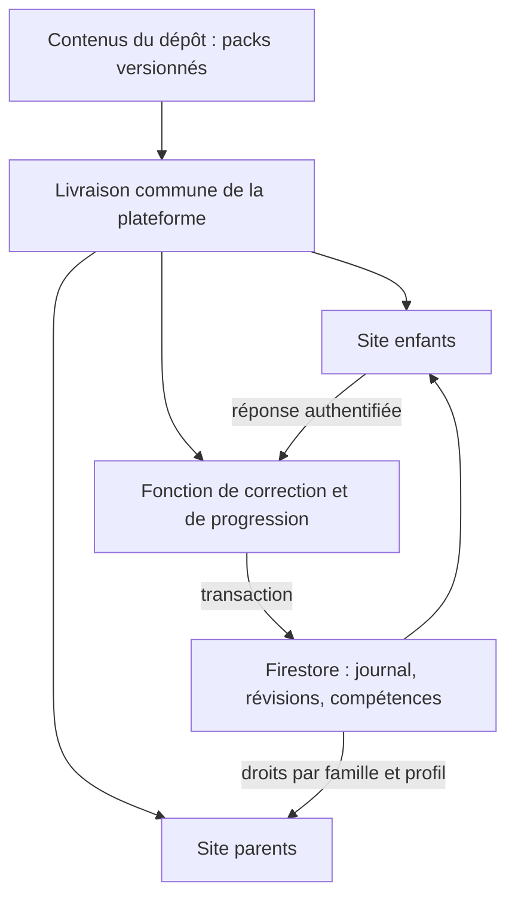

# Architecture et décisions

## Vue d’ensemble



## Un dépôt et deux espaces du même site

Les interfaces, contenus et contrats vivent dans `famille-apprentissages`. La page d’accueil mène vers `/enfants/` et `/parents/`. Un seul workflow vérifie et livre l’ensemble, ce qui évite de coordonner des versions entre plusieurs dépôts.

Les packs sont édités dans `content/`. L’import génère `packages/catalog/catalog.json`, utilisé par le navigateur et le serveur ; la CI vérifie son égalité avec les sources. Le dépôt `famille-exercices` créé au départ reste un historique, sans rôle dans les futures livraisons.

## Arborescence

```text
apps/web/                 Deux entrées de build, composants enfants / parents
content/                  Source des packs et manifeste pédagogique
packages/core/            Validation, contrats, correction, FSRS, agrégation
packages/catalog/         Catalogue importé et figé pour une livraison
functions/                API Firebase Callable ; seul chemin d’écriture des résultats
infra/                    Règles et index Firestore
scripts/                  Import, provisionnement et export
 tests/                   Contrats, moteur, droits, déduplication serveur
 docs/                    Décisions et règles d’évolution
```

## Domaines indépendants

| Domaine | Responsabilité | Extension possible |
| --- | --- | --- |
| Identité | Parent, famille, profils enfants et droits | Plusieurs parents, plusieurs appareils |
| Catalogue | Module, version, compétences, exercices | Nouvelles matières et niveaux |
| Exécution | Afficher une consigne et recueillir une réponse | Piano réel, trompette transpositrice, dictée audio |
| Évaluation | Interpréter la réponse selon le type d’activité | Diagnostic, erreurs détaillées, indices |
| Révision | Quand représenter une question | Politiques différentes du FSRS pour certains exercices |
| Suivi | Journal durable et projections par compétence | Objectifs parentaux, tendances, exports |
| Stockage | Authentifier, lire, enregistrer | Autre fournisseur derrière les mêmes contrats |

Le catalogue ne contient pas de code exécutable. Les trois renderers actuels sont dans la plateforme. Un nouveau type d’exercice ajoute un renderer, un validateur et un évaluateur dans la même PR ; de nouvelles questions de types connus ne nécessitent que du contenu.

## Contrats et données

Chemins Firestore :

- `families/{familyId}` : métadonnées de la famille.
- `families/{familyId}/learners/{learnerId}` : prénom/pseudonyme et niveau.
- `.../events/{attemptId}` : résultat serveur immuable, empreinte de la requête et calendrier retourné.
- `.../reviews/{moduleId}__{exerciseId}` : état de répétition par question.
- `.../progress/{moduleId}__{skillId}` : projection par compétence.

Une réponse porte `schemaVersion`, UUID, enfant, module, version du module, révision du catalogue, exercice, réponse, durée et éventuellement autoévaluation. Le navigateur ne fournit ni son rôle ni un score faisant autorité. Les rôles proviennent de Firebase Auth et sont attribués par l’administration.

Le serveur valide le contrat, vérifie la famille et l’enfant, vérifie le catalogue, corrige, puis crée le journal et met à jour les projections dans **une transaction**. Une répétition réseau du même UUID renvoie le même accusé ; un UUID réutilisé avec une autre réponse est refusé. Deux réponses distinctes concurrentes sont sérialisées par les transactions Firestore.

Les horodatages de progression sont ceux du serveur. La durée déclarée est un indicateur d’usage, pas une mesure fiable d’attention. Aucune donnée audio n’est conservée.

## Suivi parent qui suit les nouveaux exercices

Le tableau parent lit les projections communes et résout les libellés à partir du même catalogue que le hub. Une nouvelle compétence d’un module existant apparaît automatiquement. Les identifiants restent affichables même si un ancien module n’existe plus dans le catalogue actuel.

Une question peut travailler plusieurs compétences : elle compte une fois par compétence, mais une seule fois dans le nombre global de réponses (obtenu par les cartes de révision). Les autoévaluations de flashcards ne sont jamais présentées comme des réussites corrigées. Les pourcentages sont des observations sur les exercices joués, pas des niveaux de maîtrise scolaires.

## Répétition espacée et Anki

Le moteur utilise réellement `ts-fsrs` 5.4.2 (MIT), derrière une petite fonction d’adaptation. Il ne copie pas l’application Anki et n’implémente pas la synchronisation AnkiWeb. Les réponses corrigées sont traduites en Again / Good ; les cartes mémoire permettent les quatre évaluations. Conserver cette politique dans les journaux et la documenter avant tout changement.

Un import APKG/CSV pourra convertir des notes et modèles compatibles dans des modules de cartes mémoire. Les médias, le HTML et le JavaScript des paquets importés devront être traités explicitement ; aucun import libre n’est actif.

Sources : [TS-FSRS](https://github.com/open-spaced-repetition/ts-fsrs), [Callable Firebase](https://firebase.google.com/docs/functions/callable), [règles Firestore](https://firebase.google.com/docs/firestore/security/rules-conditions).

## Livraison et compatibilité

La CI valide les contrats, les contenus, le moteur, les droits et les deux builds. Un changement de contenu met à jour les packs et leur catalogue embarqué dans le même commit. La livraison inclut les deux sites et la fonction backend. Firebase ne déploie pas ces composants comme une transaction globale : un ancien client peut donc recevoir `CATALOG_MISMATCH` et doit être rechargé. C’est préférable à une correction contre une mauvaise version.

Les données brutes sont conservées pour pouvoir recalculer les projections. Une migration de schéma introduira une nouvelle version et un script idempotent, avec export préalable. Ne jamais réinterpréter silencieusement un ancien résultat selon une nouvelle règle.

## Limites et évolutions

La démo est locale ; la synchronisation multiappareil nécessite un vrai projet Firebase. Le mode connecté confirme chaque réponse avant de poursuivre : une file hors connexion persistante est une extension future, avec le même UUID de déduplication. Il n’y a ni diagnostic scolaire complet, ni gestion des modules depuis une interface admin, ni moteur d’analyse audio dans ce socle.

Un calendrier de suppression/export, une interface de gestion des comptes et une récupération du compte enfant sont à ajouter avant un usage élargi au-delà de la famille. Le script d’export fournit déjà une sortie exploitable hors du fournisseur.
